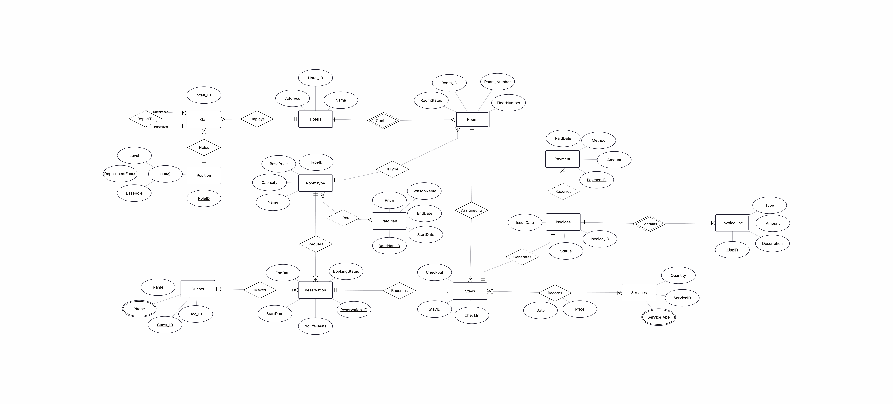
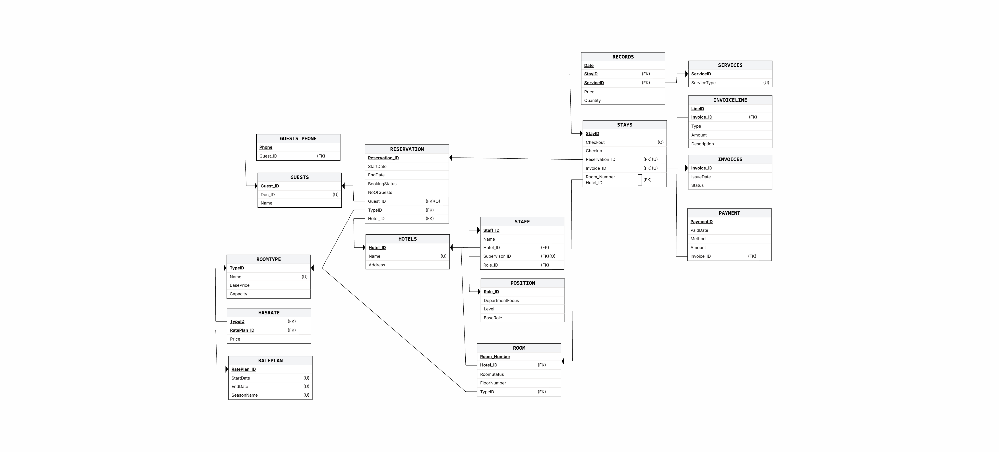

# Hotel Management System

A decoupled Java domain model and relational database architecture for an end-to-end hotel management system.

---

##  Overview

This project provides a structural object-oriented domain model and corresponding relational schema for core hotel operations, including room inventory, guest registration, staff management, booking lifecycle, service tracking, and invoicing.

---

##  System Diagrams

### 1. Entity Relationship Diagram (ERD)


### 2. UML Class Diagram


---

##  Domain Architecture

The core entities are structured into five main subsystems:

- **Hotel Structure**: `Hotel`, `Floor`, `Room`, `RoomType`, `RatePlan`
- **Guest & Identity**: `Guest`, `IdentityDocument`
- **Staff Hierarchy**: `Staff` (Abstract), `Manager`, `Receptionist`, `Housekeeper`
- **Reservation & Stay**: `Reservation`, `Stay`
- **Billing & Services**: `Service`, `ServiceConsumption`, `Invoice`, `InvoiceLine`, `Payment`

---

## 🗄 Relational Database Schema (DDL)

```
DROP DATABASE IF EXISTS `Hotel_Management_Group3`;
CREATE DATABASE `Hotel_Management_Group3`
  CHARACTER SET utf8mb4
  COLLATE utf8mb4_unicode_ci;
USE `Hotel_Management_Group3`;

CREATE TABLE Hotels (
    Hotel_ID INT NOT NULL,
    Name CHAR(100) NOT NULL,
    Address CHAR(150) NOT NULL,
    CONSTRAINT PK_Hotels PRIMARY KEY (Hotel_ID),
    CONSTRAINT UQ_Hotels_Name UNIQUE (Name)
) ENGINE=InnoDB;

CREATE TABLE Position (
    Role_ID INT NOT NULL,
    DepartmentFocus VARCHAR(50) NOT NULL,
    Level ENUM('Junior','Senior','Supervisor','Manager'),
    BaseRole VARCHAR(50) NOT NULL,
    CONSTRAINT PK_Position PRIMARY KEY (Role_ID),
    CONSTRAINT UQ_Position_Title UNIQUE (BaseRole, DepartmentFocus, Level)
) ENGINE=InnoDB;

CREATE TABLE Staff (
    Staff_ID INT NOT NULL,
    Name VARCHAR(100) NOT NULL,
    Supervisor_ID INT NULL,
    Hotel_ID INT NOT NULL,
    Role_ID INT NOT NULL,
    CONSTRAINT PK_Staff PRIMARY KEY (Staff_ID),
    CONSTRAINT FK_Staff_Hotels FOREIGN KEY (Hotel_ID)
        REFERENCES Hotels (Hotel_ID)
        ON DELETE RESTRICT ON UPDATE CASCADE,
    CONSTRAINT FK_Staff_Position FOREIGN KEY (Role_ID)
        REFERENCES Position (Role_ID)
        ON DELETE RESTRICT ON UPDATE CASCADE,
    CONSTRAINT FK_Staff_Supervisor FOREIGN KEY (Supervisor_ID)
        REFERENCES Staff (Staff_ID)
        ON DELETE SET NULL ON UPDATE CASCADE
) ENGINE=InnoDB;

CREATE TABLE RoomType (
    TypeID INT NOT NULL,
    Name CHAR(100) NOT NULL,
    BasePrice DECIMAL(12,2) NOT NULL,
    Capacity INT NOT NULL,
    CONSTRAINT PK_RoomType PRIMARY KEY (TypeID),
    CONSTRAINT UQ_RoomType_Name UNIQUE (Name),
    CONSTRAINT CHK_RoomType_Price CHECK (BasePrice >= 0),
    CONSTRAINT CHK_RoomType_Capacity CHECK (Capacity BETWEEN 1 AND 5)
) ENGINE=InnoDB;

CREATE TABLE RatePlan (
    RatePlan_ID INT NOT NULL,
    SeasonName VARCHAR(50) NOT NULL,
    StartDate DATETIME NOT NULL,
    EndDate DATETIME NOT NULL,
    CONSTRAINT PK_RatePlan PRIMARY KEY (RatePlan_ID),
    CONSTRAINT UQ_RatePlan_SeasonName UNIQUE (SeasonName),
    CONSTRAINT CHK_RatePlan_Dates CHECK (EndDate >= StartDate)
) ENGINE=InnoDB;

CREATE TABLE Room (
    Hotel_ID    INT NOT NULL,
    Room_Number VARCHAR(10) NOT NULL,
    RoomStatus  ENUM('Available','Occupied','Maintenance') NOT NULL,
    FloorNumber INT NOT NULL,
    TypeID      INT NOT NULL,
    CONSTRAINT PK_Room PRIMARY KEY (Hotel_ID, Room_Number),
    CONSTRAINT FK_Room_Hotels FOREIGN KEY (Hotel_ID)
        REFERENCES Hotels (Hotel_ID)
        ON DELETE RESTRICT ON UPDATE CASCADE,
    CONSTRAINT FK_Room_RoomType FOREIGN KEY (TypeID)
        REFERENCES RoomType (TypeID)
        ON DELETE RESTRICT ON UPDATE CASCADE
) ENGINE=InnoDB;

CREATE TABLE Guests (
    Guest_ID INT NOT NULL,
    Doc_ID   VARCHAR(20) NOT NULL,
    Name     VARCHAR(100) NOT NULL,
    CONSTRAINT PK_Guests PRIMARY KEY (Guest_ID),
    CONSTRAINT UQ_Guests_DocID UNIQUE (Doc_ID)
) ENGINE=InnoDB;

CREATE TABLE Services (
    ServiceID   INT NOT NULL,
    ServiceType VARCHAR(50) NOT NULL,
    CONSTRAINT PK_Services PRIMARY KEY (ServiceID),
    CONSTRAINT UQ_Services_ServiceType UNIQUE (ServiceType)
) ENGINE=InnoDB;

CREATE TABLE HasRate (
    TypeID INT NOT NULL,
    RatePlan_ID INT NOT NULL,
    Price DECIMAL(12,2) NOT NULL,
    CONSTRAINT PK_HasRate PRIMARY KEY (TypeID, RatePlan_ID),
    CONSTRAINT FK_HasRate_RoomType FOREIGN KEY (TypeID)
        REFERENCES RoomType (TypeID)
        ON DELETE CASCADE ON UPDATE CASCADE,
    CONSTRAINT FK_HasRate_RatePlan FOREIGN KEY (RatePlan_ID)
        REFERENCES RatePlan (RatePlan_ID)
        ON DELETE CASCADE ON UPDATE CASCADE,
    CONSTRAINT CK_HasRate_Price CHECK (Price >= 0)
) ENGINE=InnoDB;

CREATE TABLE Guests_Phone (
    Phone VARCHAR(20) NOT NULL,
    Guest_ID INT NOT NULL,
    CONSTRAINT PK_Guests_Phone PRIMARY KEY (Phone, Guest_ID),
    CONSTRAINT FK_GuestsPhone_Guests FOREIGN KEY (Guest_ID)
        REFERENCES Guests (Guest_ID)
        ON DELETE CASCADE ON UPDATE CASCADE
) ENGINE=InnoDB;

CREATE TABLE Reservation (
    Reservation_ID INT NOT NULL,
    StartDate DATE NOT NULL,
    EndDate DATE NOT NULL,
    BookingStatus VARCHAR(50) NOT NULL,
    NoOfGuests INT NOT NULL,
    Guest_ID INT NULL,
    TypeID INT NOT NULL,
    CONSTRAINT PK_Reservation PRIMARY KEY (Reservation_ID),
    CONSTRAINT CHK_Reservation_Guests CHECK (NoOfGuests > 0),
    CONSTRAINT CHK_Reservation_Dates CHECK (EndDate >= StartDate),
    CONSTRAINT FK_Reservation_Guests FOREIGN KEY (Guest_ID)
        REFERENCES Guests (Guest_ID)
        ON DELETE SET NULL ON UPDATE CASCADE,
    CONSTRAINT FK_Reservation_RoomType FOREIGN KEY (TypeID)
        REFERENCES RoomType (TypeID)
        ON DELETE RESTRICT ON UPDATE CASCADE
) ENGINE=InnoDB;

CREATE TABLE Invoices (
    Invoice_ID INT NOT NULL,
    IssueDate DATE NOT NULL,
    Status VARCHAR(50) NOT NULL,
    CONSTRAINT PK_Invoices PRIMARY KEY (Invoice_ID)
) ENGINE=InnoDB;

CREATE TABLE Stays (
    StayID INT NOT NULL,
    CheckIn DATETIME NOT NULL,
    Checkout DATETIME NULL,
    Reservation_ID INT NOT NULL,
    Invoice_ID INT NOT NULL,
    Hotel_ID INT NOT NULL,
    Room_Number VARCHAR(10) NOT NULL,
    CONSTRAINT PK_Stays PRIMARY KEY (StayID),
    CONSTRAINT CHK_Stays_Dates CHECK (Checkout IS NULL OR Checkout >= CheckIn),
    CONSTRAINT FK_Stays_Reservation FOREIGN KEY (Reservation_ID)
        REFERENCES Reservation (Reservation_ID)
        ON DELETE RESTRICT ON UPDATE CASCADE,
    CONSTRAINT FK_Stays_Invoices FOREIGN KEY (Invoice_ID)
        REFERENCES Invoices (Invoice_ID)
        ON DELETE RESTRICT ON UPDATE CASCADE,
    CONSTRAINT FK_Stays_Room FOREIGN KEY (Hotel_ID, Room_Number)
        REFERENCES Room (Hotel_ID, Room_Number)
        ON DELETE RESTRICT ON UPDATE CASCADE
) ENGINE=InnoDB;

CREATE TABLE Records (
    StayID INT NOT NULL,
    ServiceID INT NOT NULL,
    Date DATETIME NOT NULL,
    Price DECIMAL(12,2) NOT NULL,
    Quantity INT NOT NULL,
    CONSTRAINT PK_Records PRIMARY KEY (Date, StayID, ServiceID),
    CONSTRAINT CHK_Records_Price CHECK (Price >= 0),
    CONSTRAINT CHK_Records_Qty CHECK (Quantity > 0),
    CONSTRAINT FK_Records_Stays FOREIGN KEY (StayID)
        REFERENCES Stays (StayID)
        ON DELETE CASCADE ON UPDATE CASCADE,
    CONSTRAINT FK_Records_Services FOREIGN KEY (ServiceID)
        REFERENCES Services (ServiceID)
        ON DELETE RESTRICT ON UPDATE CASCADE
) ENGINE=InnoDB;

CREATE TABLE InvoiceLine (
    LineID INT NOT NULL,
    Invoice_ID INT NOT NULL,
    Type VARCHAR(50) NOT NULL,
    Amount DECIMAL(12,2) NOT NULL,
    Description VARCHAR(255),
    CONSTRAINT PK_InvoiceLine PRIMARY KEY (LineID, Invoice_ID),
    CONSTRAINT CHK_InvoiceLine_Amount CHECK (Amount >= 0),
    CONSTRAINT FK_InvoiceLine_Invoices FOREIGN KEY (Invoice_ID)
        REFERENCES Invoices (Invoice_ID)
        ON DELETE CASCADE ON UPDATE CASCADE
) ENGINE=InnoDB;

CREATE TABLE Payment (
    PaymentID INT NOT NULL,
    PaidDate DATETIME NOT NULL,
    Method VARCHAR(50) NOT NULL,
    Amount DECIMAL(12,2) NOT NULL,
    Invoice_ID INT NOT NULL,
    CONSTRAINT PK_Payment PRIMARY KEY (PaymentID),
    CONSTRAINT CHK_Payment_Amount CHECK (Amount > 0),
    CONSTRAINT FK_Payment_Invoices FOREIGN KEY (Invoice_ID)
        REFERENCES Invoices (Invoice_ID)
        ON DELETE RESTRICT ON UPDATE CASCADE
) ENGINE=InnoDB;

```
### SQL Query

The `Query/` folder contains the SQL scripts and documentation for the Hotel Management System.

- Database schema and sample data
- 14 SQL queries (Q1–Q14)
- DML operations and transactions
- Constraint testing
- SQL query report

See the [Query folder](./Query/) for details.

**Note:** `01_schema.sql` is for testing only. Do not run it on the shared database without approval.
