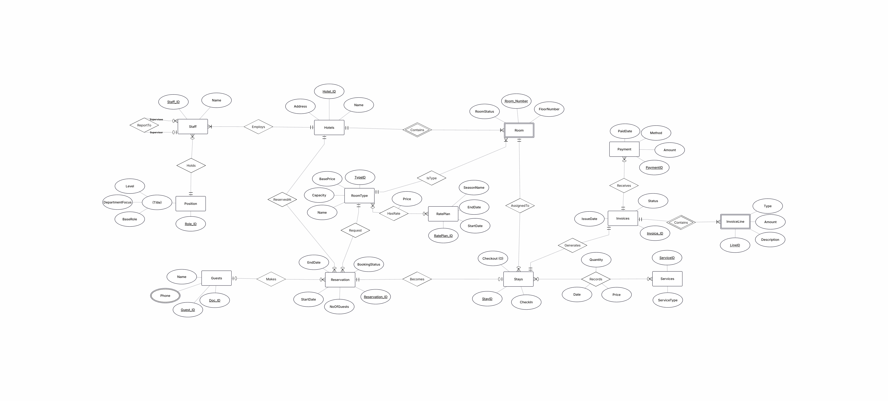
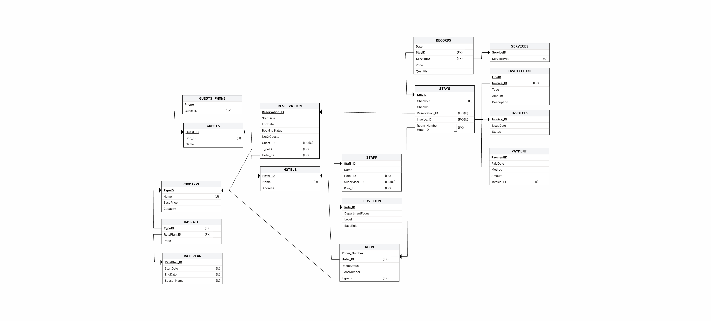

# Hotel Management System

Group 3, Principles of Database Management (IT079IU), topic 23: Hotel Management.

A relational database and a Java domain model for a hotel chain: hotels, rooms, room types and seasonal prices, staff, guests, reservations, stays, services, invoices and payments.

Database system: **MySQL 8.0 or later** (MySQL Workbench 8.0).

---

## System diagrams

### 1. Entity Relationship Diagram (ERD)

### 2. Relational Schema

---

## Repository structure

| Folder or file | Content |
|---|---|
| `Database/hotel_management_full.sql` | The single setup script: drops and recreates the database `Hotel_Management_Group3`, creates the 16 tables, indexes and triggers, and loads the sample data |
| `Database/business_rules_report.md` | Business rules and how each one is enforced (constraints, triggers, transactions) |
| `Diagram/` | ERD and Relational Schema (images and ErdPlus files) |
| `Query/` | The 13 queries, relational algebra images, index demonstration, update statements with transactions, constraint tests, and the query report |
| `src/` | Java source code (domain model and database connection) |

---

## How to run the database

1. Open MySQL Workbench and connect to a MySQL 8.0 (or later) server.
2. Run `Database/hotel_management_full.sql`. The script can be run again at any time; each run restores the original sample data.
3. Then run the files in `Query/`, in this order:
   1. `queries.sql`
   2. `explain_index.sql`
   3. `crud_transaction_tests.sql`
   4. `constraint_tests.sql` (one statement at a time; each statement must return the error written above it)

See `Query/README_1.md` for the details of each file.

---

## Domain architecture (Java)

The core entities are structured into five main subsystems:

- **Hotel Structure**: `Hotel`, `Floor`, `Room`, `RoomType`, `RatePlan`
- **Guest & Identity**: `Guest`, `IdentityDocument`
- **Staff Hierarchy**: `Staff` (Abstract), `Manager`, `Receptionist`, `Housekeeper`
- **Reservation & Stay**: `Reservation`, `Stay`
- **Billing & Services**: `Service`, `ServiceConsumption`, `Invoice`, `InvoiceLine`, `Payment`

The database connection is implemented in `src/hotel/model/DatabaseConnection.java`.

---

## Database summary

- 16 tables, 18 foreign keys (each with ON DELETE and ON UPDATE), at least 15 sample rows in every table.
- Constraints: PRIMARY KEY, FOREIGN KEY, NOT NULL, UNIQUE, CHECK and DEFAULT.
- Business rules that compare rows or tables are enforced with 6 triggers (room capacity, room type of a reservation, hotel and room of a stay, overlapping stays, overlapping rate plans).
- Operations that change several tables (check-in, check-out, payment) run inside transactions with COMMIT and ROLLBACK.
- Indexes: `IDX_Stays_Room_Dates`, `IDX_RatePlan_Dates`, `IDX_Reservation_Hotel_Dates`.
